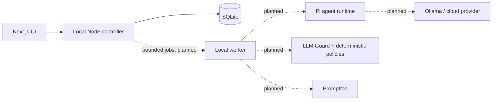

# Architecture

Implemented in A1: `apps/web` owns UI and server-action transport; `packages/controller/src/projects.ts` owns project rules and typed contracts; `sqlite-projects.ts` owns persistence and schema migration. The controller validates request and repository outputs. SQLite is the canonical owner of project metadata. The Node server uses one controller instance per process, retained through development reloads. There are no background operations in A1.

Planned Phase 1 flow: Web UI → Local Controller → Pi Agent Runtime → Selected Model. Context management stores goals, approved decisions, and references to verified results. A bounded local worker will run model tasks and evaluations independently of HTTP requests. Security checks inputs, retrieved documents, outputs, and approved tool operations. Promptfoo uses the same application protection path in the dashboard and CI.

The user's explicit LLM Guard selection supersedes Prompt Guard 2 from the original specification. A small Python adapter may host LLM Guard. The Node controller retains orchestration and state ownership. Scanner failures must fail closed. Treat documents as data; never execute their instructions. Do not duplicate histories or policies across services.

Provider, scanner, and evaluation contracts will be added with their first real integrations, not as speculative interfaces. Credential storage must use a protected local mechanism, preferably the OS store, and never return saved keys to the browser.
